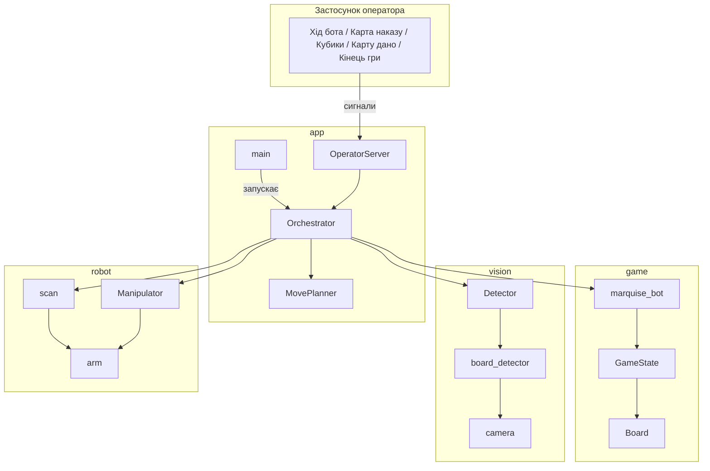
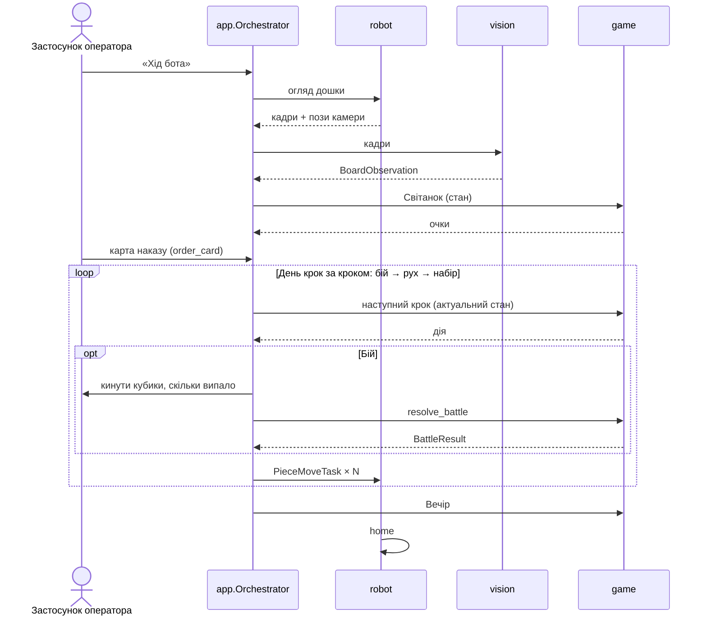

# Архітектура

## Принципи

1. **Кожен модуль можна розробляти без інших.** `game` не знає про камеру й робота, `robot` не знає правил гри,
   `vision` не знає, що робить бот. Їх з'єднує лише `app`.
2. **Камера — джерело істини про дошку.** Перед кожним ходом бота стан фігурок будується з кадрів заново.
   Програма пам'ятає тільки те, чого не видно: рахунок, Keep, пріоритети.
3. **Людина взаємодіє з ботом лише через застосунок оператора** ([ADR 0006](decisions/0006-operator-app.md)).

## Модулі

Нижче — зовнішній опис кожного компонента; деталі реалізації — у docstring самого файлу.

### app — точка входу й оркестратор партії

- **`main`** — запускає програму (`python -m rootbot.app.main`): читає конфігурацію, створює всі компоненти
  і запускає `Orchestrator`. Якщо компонент не створився — зупиняється з повідомленням. Код: [`app/main.py`](../src/rootbot/app/main.py).
- **`Orchestrator`** — веде партію: Behaviour Tree на `py_trees` ([ADR 0007](decisions/0007-behaviour-tree.md)). Чекає
  сигналів із застосунку й проводить хід — огляд → стан дошки (`vision`) → Світанок → День крок за кроком (`game`) →
  перенесення фігурок (`robot`) → Вечір → home. Невдалий крок повторює, потім чекає людину. Сам нічого не рахує й не
  рухає. Вимоги: [requirements/orchestrator.md](requirements/orchestrator.md). Код: [`app/orchestrator.py`](../src/rootbot/app/orchestrator.py).
- **`MovePlanner`** — дії бота → конкретні переміщення: яких котів узяти й куди поставити (вільне місце в колі галявини шукає сам), жетон рахунку.
  Код: [`app/move_planner.py`](../src/rootbot/app/move_planner.py).
- **`OperatorServer`** — зв'язок із застосунком оператора: приймає сигнали й віддає поточний стан бота. Приймає лише
  сигнал, якого бот чекає зараз (`WaitingFor`), і «Кінець гри» будь-коли. Сигнали — через `queue.Queue`, стан —
  спільний об'єкт під `threading.Lock` ([ADR 0006](decisions/0006-operator-app.md)). Зараз це частина тієї самої
  програми; HTTP-сервер у фоновому потоці — заплановано. Вимоги й методи: [requirements/operator-server.md](requirements/operator-server.md).
  Код: [`app/operator_ui.py`](../src/rootbot/app/operator_ui.py).

### game — правила бота: стан дошки + карта наказу → дії

- **`Board`** — мапа: 12 галявин, їхні масті, сусіди й пріоритети бота. Завантажується з `config/maps/autumn.yaml`. Код: [`game/board.py`](../src/rootbot/game/board.py).
- **`GameState`** — стан партії: хто що має на кожній галявині. Відповідає на питання правил: хто панує, де вороги, кого бот обирає захисником. Код: [`game/state.py`](../src/rootbot/game/state.py).
- **`marquise_bot`** — бот Механічна Маркіза: Світанок, День (бій / рух / набір) і Вечір за правилами з [game-rules.md](game-rules.md). На вхід стан і карта наказу, на вихід дії; після кидка кубиків `resolve_battle` рахує втрати (`BattleResult`). Карта без вартості крафту (`recruits` повертає `None`) — День повторюється з наступною картою. Код: [`game/marquise_bot.py`](../src/rootbot/game/marquise_bot.py).
- **`actions`** — дії, які видає бот: `Battle` (бій на галявині), `Move` (перемістити воїнів), `Recruit` (набрати воїнів), `Score` (очки), а також `BattleResult` (втрати після бою). Код: [`game/actions.py`](../src/rootbot/game/actions.py).

### vision — кадри огляду → стан дошки

- **`Detector`** — головний клас зору: з кадрів огляду знаходить фігурки й приписує їх до галявин: каже лише, хто де стоїть. Заплановано: коти в запасі на планшеті бота, маркери рахунку. Повертає `BoardObservation` і `RecheckRequest` — що варто переглянути, щоб уточнити його (цикл покращень). Код: [`vision/detector.py`](../src/rootbot/vision/detector.py).
- **`PieceDetectorModel`** — модель фігурок за інтерфейсом: кадри → рамки (`PieceBox`). Реалізацію (YOLO тощо) обирає конфіг; поки заглушка. Код: [`vision/piece_detector_model.py`](../src/rootbot/vision/piece_detector_model.py).
- **`BoardMask`** — частина дошки як растр у мм: що треба побачити в огляді (уся дошка, галявини, інше) і скільки її покривають кадри. Код: [`vision/board_mask.py`](../src/rootbot/vision/board_mask.py).
- **`board_detector`** — знаходить дошку й планшет бота на кадрі за їхнім малюнком: `BoardHomography` — піксель ↔ мм дошки й яку частину дошки видно ([vision.md](vision.md)). Вимоги до зору: [requirements/detector.md](requirements/detector.md). Код: [`vision/board_detector.py`](../src/rootbot/vision/board_detector.py).
- **`board_reference`** — еталон дошки й планшета: знімок → вирівняне зображення в мм + характерні точки. Готується один раз скриптом `scripts/make_board_reference.py`. Код: [`vision/board_reference.py`](../src/rootbot/vision/board_reference.py).
- **`geometry`** (заплановано) — рамка фігурки на кадрі → точка її основи → точка на площині дошки в мм ([calibration.md](calibration.md)). Зараз цей перехід робить `Detector` через `BoardHomography`.
- **`camera`** — кадри для огляду: `FolderCamera` читає їх з теки на диску (`camera.source: folder`); камера RealSense — заплановано. Код: [`vision/camera.py`](../src/rootbot/vision/camera.py).
- **`observation`** — `BoardObservation` — що `vision` повертає в `app`: кількості фігурок по галявинах (`pieces`), де стоїть кожна фігурка по фракціях (`positions`), усі зайняті точки разом із Keep (`occupied`), галявина Keep (`keep_clearing`), ПО з доріжки рахунку (`scores`, читання маркерів — заплановано), впевненість (`confidence`). Код: [`vision/observation.py`](../src/rootbot/vision/observation.py).

Детектор фігурок навчається окремо в [`ml/`](ml.md); до програми доходять лише ваги в `models/`.

### robot — рука: огляд і перенесення фігурок

- **`Manipulator`** — переносить одну фігурку: взяти в одній точці, поставити в іншій (галявина або планшет бота). На вхід `PieceMoveTask`. Поки заглушка: пише задачу в лог. Заплановано: рух руки й перевірка, що точки в робочій зоні, до руху. Код: [`robot/manipulator.py`](../src/rootbot/robot/manipulator.py).
- **`Scanner`** — огляд: рука стає в оглядові пози й знімає кадри на зупинках (спершу майже згори; на `RecheckRequest` детектора сам вирішує, як дознімати). Поки поз немає: один кадр з поточного місця на кожен огляд. Заплановано: кадр зблизька перед захватом. Код: [`robot/scan.py`](../src/rootbot/robot/scan.py).
- **`arm`** — рука: `MockArm` (без робота, рухи пишуться в лог) і `XArm` (справжня, через xArm SDK; заплановано). Решта коду знає лише `Protocol` `Arm`, тож вони взаємозамінні. Код: [`robot/arm.py`](../src/rootbot/robot/arm.py).
- **`hand_eye`** (заплановано) — де камера на руці: поза камери для будь-якої пози руки ([calibration.md](calibration.md)).
- **`transforms`** — перетворення точок і поз між системами координат: камера, фланець, робот, дошка. Код: [`robot/transforms.py`](../src/rootbot/robot/transforms.py).

### common — спільні типи

- **`types`** — масті, фракції, номери галявин, кількість фігурок на галявині (`PieceCounts`), карта наказу (`OrderCard`), точка на дошці в мм (`BoardPoint`). Контракт між модулями: змінюємо лише через PR, який переглядають власники всіх модулів, що їх використовують. Код: [`common/types.py`](../src/rootbot/common/types.py).

## Цикл ходу бота

Діаграма ходу

## Де що ще

| Тема | Де |
| --- | --- |
| Системи координат, калібрування камери на руці | [calibration.md](calibration.md) |
| Конфігурація (`config/`) | [config/default.yaml](../config/default.yaml) — коментарі біля кожного параметра |
| ML: датасети й навчання детектора | [ml.md](ml.md), [ADR 0004](decisions/0004-ml-pipeline.md) |
| Вимоги до компонентів (FR / NFR) | [requirements/](requirements/) |
| Що зараз робить людина, а згодом робот | [autonomy.md](autonomy.md) |
| Рішення й чому так | [decisions/](decisions/) |
