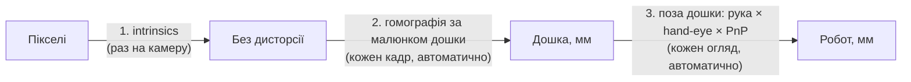

# Калібрування

Ланцюжок: **пікселі → мм дошки → мм бази робота**. Раз калібруються лише камера (intrinsics) і те,
як вона закріплена на руці (hand-eye); де дошка, рахується заново на кожному огляді.

## 1. Внутрішні параметри камери (intrinsics)

**Коли:** один раз для кожної камери, а також якщо змінили роздільність чи фокус.

1. Надрукувати шахівницю (напр. 9×6 клітинок по 25 мм) на жорсткій основі.
2. `python scripts/calibrate_camera.py --out config/calibration/camera.yaml`
3. Зняти 20–30 кадрів шахівниці під різними кутами по всьому полю кадру.
4. Перевірити, що похибка репроєкції < 0.5 px.

## 2. Камера → дошка

Відбувається **автоматично на кожному кадрі**, без маркерів: ключові точки кадру зіставляються з еталонним
зображенням дошки (див. [vision.md → V1](vision.md#v1-дошка)).

**Еталон** робимо один раз, а також якщо дошка почала погано знаходитися (нова камера, інше світло):

1. Виміряти зовнішні розміри дошки рулеткою (точність ±1 мм) і записати в `config/default.yaml` → `board.size_mm`.
2. Сфотографувати **порожню** дошку майже згори при робочому освітленні, без бліків.
3. `python scripts/make_board_reference.py --image <фото>`
4. Клікнути 4 кути дошки по порядку: лівий верхній (0, 0) → правий верхній (біля лого ROOT) → правий нижній →
   лівий нижній; доріжка рахунку — між двома останніми. Порядок кутів задає систему координат дошки
   (X уздовж довгої сторони, Y донизу), тож саме фото може лежати як завгодно.
5. Скрипт зберігає вид зверху з масштабом `board.warp_px_per_mm`, кола галявин поверх нього (`_check.png`)
   і шукає дошку на кадрах з `--frames`. Ціль: кола лягли на галявини, на кадрах інлаєрів не менше
   за `board.detector.min_inliers`.

Еталон у git не комітимо (це фактично скан дошки), ділимося ним так само, як вагами моделей.

## 3. Камера → рука (hand-eye)

Заплановано, коду ще немає. **Коли:** один раз, а також якщо камеру перекріпили на руці.

1. Рука проходить 10–15 поз, з яких камера бачить дошку під різними кутами (як `explore_scan_poses.py`);
   на кожній записуємо позу фланця (`tcp_pose`) і кадр.
2. Для кожного кадру `solvePnP` дає позу дошки відносно камери.
3. `cv2.calibrateHandEye` за парами «поза фланця ↔ поза дошки» дає позу камери відносно фланця
   → `config/calibration/hand_eye.yaml`.
4. Перевірка: поза дошки в системі робота з різних поз руки має збігатися (розкид ≤ 2 мм).

### Запасний варіант: дошка → робот за точками

Якщо hand-eye ще немає: одноразове 2D-перетворення дошки в систему робота. Дійсне, лише поки дошку не зсунули.

1. Поставити на захват загострений наконечник (або використати центр пальців).
2. `python scripts/calibrate_board_to_robot.py`
3. Скрипт показує еталон дошки. Клікаємо на ньому чітку точку: кут дошки або іншу деталь малюнка, яку легко
   знайти і на еталоні, і на справжній дошці. Скрипт переводить клік у мм дошки.
4. Підводимо TCP (через `jog_robot`) точно до цієї точки на справжній дошці, скрипт записує координати робота.
5. Повторюємо для 4–6 точок, рознесених якомога далі одна від одної (мінімум 3, не на одній прямій).
   До дальніх кутів дошки робот може не дотягнутися (див. [ризик №1](hardware-and-safety.md#-ризик-1-досяжність)),
   тоді беремо точки ближче.
6. За парами точок (дошка мм ↔ робот мм) рахуємо поворот + зсув методом найменших квадратів (Kabsch / Umeyama 2D).
   Якщо дивитися зверху, система дошки (Y донизу) може бути дзеркальна до бази робота: тоді перед підгонкою
   беремо (x, −y), інакше чистим поворотом точки не сумістяться. Висоту стола беремо як середнє Z.
7. Скрипт виводить залишкову похибку. Ціль: **< 2 мм** на кожній точці.
8. Результат зберігається в `config/calibration/board_to_robot.yaml`.

## Перевірка всього ланцюжка

`python scripts/calibrate_board_to_robot.py --verify`: робот по черзі показує (зависає на 10 мм над точкою)
центри всіх 12 галявин з `autumn.yaml`. Якщо десь промахується більше ніж на 5 мм, перекалібрувати.

## Висоти (Z)

| Параметр | Що це | Як визначити |
| --- | --- | --- |
| `table_z` | поверхня дошки | з калібрування (крок 3) |
| `grasp_z` | висота захвату фігурки | `table_z` + ~половина висоти фігурки, підібрати |
| `release_z` | висота відпускання | `table_z` + 1–2 мм |
| `approach_z` | звідки починаємо повільно опускатися | `table_z` + 20 мм |
| `safe_z` | висота переміщення між точками | `table_z` + 80 мм (вище за будь-яку фігурку й руку людини поруч) |
