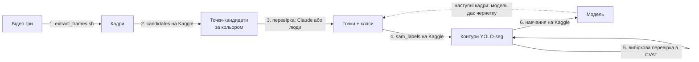

# Датасет фігурок: як ми його робимо

Задача: [#29](https://github.com/olenakshyk/RootBot67/issues/29) і підзадачі #45-#49.
Мета: модель instance segmentation, яка знаходить на фото **кожну фігурку окремо** і дає її **точний контур**
(не прямокутник): з контуру рука бере центр і поворот фігурки, а `vision` - вільне місце в галявині.

Усі важкі обчислення робимо на **Kaggle** (безкоштовно, ~30 год GPU на тиждень). На ноутбуках нічого не встановлюємо,
потрібні лише `ffmpeg` і `uv` (для команди `kaggle`).

## Схема



## Класи

Єдине джерело: [`config/piece_classes.txt`](../config/piece_classes.txt). Номер класу = номер рядка (з 0).

**Новий клас або фракцію додаємо лише в кінець файлу.** Тоді старі мітки лишаються правильними.
Після цього: оновити JSON і таблицю в [labeling.md](labeling.md), опис класу в інструкції для перевірки (крок 3)
і, якщо фракція має новий колір, `COLOURS` / `COLOUR_CLASSES` у `kaggle/candidates/candidates.py`.

## Доступ до Kaggle

- Акаунт Kaggle з підтвердженим телефоном (без цього немає GPU й інтернету в ноутбуках).
- Settings → API → Create New Token. Токен передаємо лише через змінну середовища, у файли й git не кладемо:

  ```bash
  export KAGGLE_API_TOKEN=...      # у своєму терміналі
  uvx --with six kaggle --version  # перевірка
  ```

## Кроки

### 1. Кадри з відео

```bash
scripts/extract_frames.sh data/raw_data data/frames 2   # 1 кадр кожні 2 с, без дублікатів
```

Кадри вантажимо як **приватний** датасет Kaggle `rootbot-frames`
(`data/frames/dataset-metadata.json`, потім `uvx --with six kaggle datasets create -p data/frames`;
для нової версії - `datasets version -p data/frames -m "що змінилось"`).

### 2. Кандидати за кольором

`kaggle/candidates/` - Kaggle-скрипт (CPU). Знаходить кольорові плями й ставить у кожну точку з
припущенням класу. Список кадрів - `SELECTED` у скрипті.

```bash
uvx --with six kaggle kernels push -p kaggle/candidates
uvx --with six kaggle kernels output <user>/rootbot-candidates -p data/candidates
```

Результат: `candidates.json` і прев'ю з номерами точок і сіткою координат. Кандидати мають помилки -
це лише початок для кроку 3.

### 3. Перевірка точок

Для кожного кадру: одна точка всередині кожної фігурки + правильний клас; зайві точки прибрати, пропущені додати.
Результат - `data/points/*.json` у форматі `{кадр: [{"x", "y", "cls"}]}` (пікселі повного кадру).

Зараз це робить Claude (3 паралельні помічники по 20 кадрів, ~1 год). Те саме можуть зробити люди в CVAT.

Потім усі файли зливаємо в один `points.json` і разом з `config/piece_classes.txt` вантажимо як датасет Kaggle
`rootbot-points`.

### 4. Контури через SAM

`kaggle/sam_labels/` - Kaggle-скрипт (GPU). SAM 2.1 з кожної точки будує точний контур:
спершу на всьому кадрі, потім ще раз на вирізці навколо фігурки (чіткіші краї). Пікселі, на які претендують
дві фігурки, віддаємо тій, чия точка ближче.

Результат: `dataset/` (YOLO-seg, готовий до навчання), `previews/`, `report.csv`
(стовпчик `odd_masks` - підозрілі контури, їх варто глянути) і `cvat_import.zip`.

### 5. Вибіркова перевірка в CVAT

Імпортувати `cvat_import.zip` у задачу CVAT (формат Ultralytics YOLO Segmentation 1.0), переглянути ~10 кадрів
і кадри з великим `odd_masks`, виправити. Як працювати в CVAT: [labeling.md](labeling.md).

### 6. Навчання

Буде описано в кроці 4 тікетів (#48).

## Як розширювати

- **Нова фракція:** клас у кінець `config/piece_classes.txt` → зняти відео з її фігурками → кроки 1-6.
  Модель донавчаємо зі старих ваг на старих + нових кадрах.
- **Нова камера (над столом, #49):** ті самі кроки, але на кроці 3 чернетку точок дає вже навчена модель,
  а не колір - перевірка значно швидша.
- **Більше кадрів:** додати назви в `SELECTED` (крок 2) або одразу проганяти модель.
