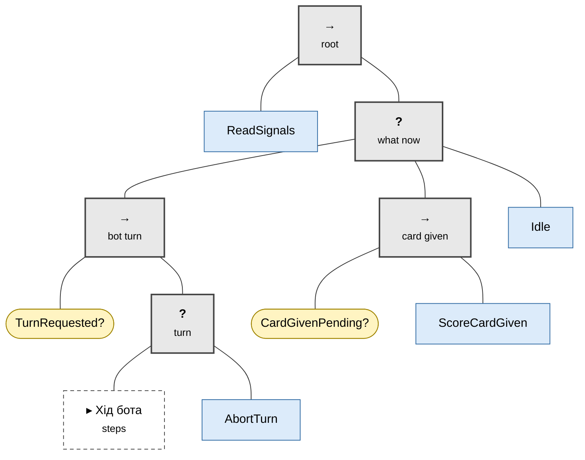
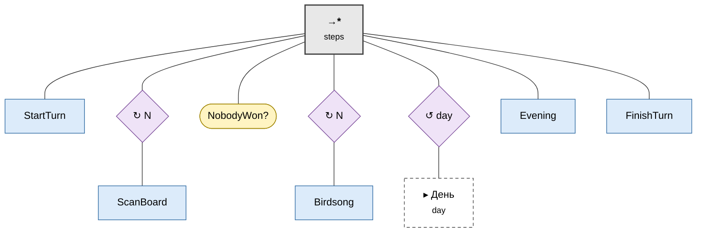
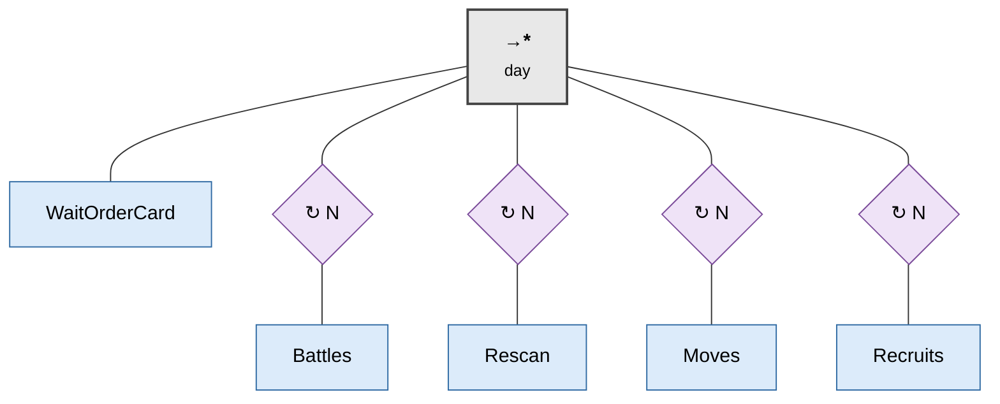

# 0007. Orchestrator — дерево поведінки (Behaviour Tree) на py_trees

## Контекст

Хід бота — це послідовність кроків (огляд → Світанок → День → Вечір), і на кількох кроках бот чекає людину:
карту наказу, кубики, допомогу після збою. Крок може не вдатися (кота не взято), тоді його треба повторити, а якщо
не допомогло — чекати людину й продовжити **з того самого місця**. Ще є сигнали, що приходять будь-коли
(«Карту дано», «Кінець гри»). Вимоги: [requirements/orchestrator.md](../requirements/orchestrator.md).

## Рішення

`Orchestrator` — **Behaviour Tree** на бібліотеці [`py_trees`](https://py-trees.readthedocs.io/) (2.x).
`build_tree()` збирає дерево, `run()` тикає його кожні `orchestrator.tick_period_s`, поки не кінець гри.
Код: [`app/orchestrator.py`](../../src/rootbot/app/orchestrator.py).

## Чому

| Варіант | Мінуси |
| --- | --- |
| Звичайний цикл `while` з `if` | повтори, очікування людини й «продовжити з того самого кроку» розмазуються по коду прапорцями |
| Скінченний автомат (FSM) | для кожної пари станів — свій перехід; додати «повтор» чи «чекати людину» = дописати переходи з **кожного** стану |
| **Behaviour Tree** | повтор, очікування й пріоритети — окремі вузли, які обгортають будь-який крок; дерево видно цілком |

BT — це той самий автомат станів, тільки переходи не пишуться вручну: їх задає будова дерева. Поширене в
робототехніці (ROS 2 Nav2) та іграх.

## Наше дерево

### 1. Партія

Корінь тикається щотику: спершу читає сигнали, потім обирає, що робити, за пріоритетом зліва направо.




- `what now`: хід бота, якщо його попросили → «Карту дано», якщо є → інакше `Idle` (чекати «Хід бота»).
- `turn`: якщо хід дав `FAILURE` (хтось набрав 30 ПО), `AbortTurn` відправляє руку в home і завершує хід.

### 2. Хід бота

Sequence з пам'яттю (`→*`): після `RUNNING` наступний тик продовжує з того самого кроку.



- `↻ N` — один і той самий декоратор `RetryOrAskHuman` над різними кроками: N =
  `orchestrator.step_retries` повторів, потім рука в home, статус «потрібна допомога» і `RUNNING`, доки людина не
  натисне «Хід бота». Тоді той самий крок іде знову.
- `NobodyWon?` — умова: `FAILURE`, якщо хтось має `game.win_points` ПО (тоді й кінець гри).
- `↺ day` (`RepeatDay`) — День ще раз з наступною картою, поки в Розкладі є карти.
- Світанок і Вечір — по одному вузлу: у них немає чекання людини й окремих збоїв. День розписаний по кроках, бо
  там чекання карти й кубиків і чотири різні дії руки, кожна з яких може не вдатися окремо.

### 3. День



- `WaitOrderCard` — чекає карту наказу: людина відкриває ліву карту Розкладу й вводить у застосунку її масть і
  вартість крафту (тимчасово; згодом рука з камерою). Поки карти немає — `RUNNING`.
- `Battles` — по черзі кожен бій: `RUNNING`, поки людина не введе кубики; втрати бота прибирає рука.
- `Rescan` — огляд лише галявин боїв (втрати людей прибирають люди).

**Позначення (для всіх схем):**
- **`→` Sequence** — виконує дітей зліва направо, поки всі успішні; **`?` Fallback** — пробує дітей зліва направо,
  поки один не вдасться; **`*`** — з пам'яттю: після «ще працюю» продовжує з того самого кроку, а не з початку;
- **ромб** — декоратор: змінює, як виконується його єдина дитина. **`↻ N`** — до N повторів
  (`orchestrator.step_retries`), далі чекати людину; **`↺ day`** — День ще раз, якщо карта без вартості крафту;
- **прямокутник** — дія (огляд, рух руки, очки); **овал** — умова, лише перевіряє «так / ні»;
- **пунктир ▸** — піддерево, розгорнуте на наступній схемі; під символом вузла дрібно — його назва в коді.

Дерево **тикають** (tick) з кореня багато разів на секунду. Кожен вузол на тик повертає один із трьох статусів:

| Статус | Значення |
| --- | --- |
| `SUCCESS` | зроблено |
| `FAILURE` | не вдалося / умова хибна |
| `RUNNING` | ще працюю (або чекаю) — тикни мене ще раз |

## Підказки по py_trees

```python
class Wait(py_trees.behaviour.Behaviour):  # свій вузол-дія
    def update(self) -> Status:            # кожен тик повертає SUCCESS / FAILURE / RUNNING
        return Status.RUNNING

py_trees.composites.Sequence("name", memory=True, children=[a, b])   # →*
py_trees.composites.Selector("name", memory=False, children=[a, b])  # ?
tree = py_trees.trees.BehaviourTree(root)
tree.tick()
```

- Дані між вузлами — наш `TurnContext` замість `Blackboard` з py_trees (типи перевіряє mypy).
- Виняток у вузлі `Step` перетворює на `FAILURE`; `FatalError` зупиняє програму.
- Документація: [py-trees.readthedocs.io](https://py-trees.readthedocs.io/).
