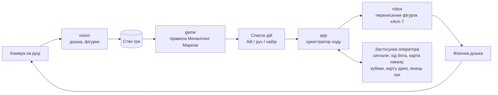

# Огляд проєкту

## Ідея

Механічна Маркіза — це бот, який грає за чіткими правилами: відкриває карту наказу; масть карти визначає,
де він атакує й рухається, а вартість крафту — де він набирає воїнів. Людині грати за такого бота нудно, бо це механічна
робота. Тому ми віддаємо її роботу: **камера** знімає дошку і рахує фігурки на кожній галявині, **ігровий рушій**
застосовує правила бота й видає список дій, **роборука** виконує ці дії фізично.

## Як це працює

Хід бота складається з таких кроків:

1. Люди завершують свої ходи й натискають «Хід бота».
2. Камера фотографує дошку, `vision` перетворює фото на стан: скільки чиїх фігурок стоїть на кожній галявині.
3. Оператор перевертає ліву карту наказу й вводить її масть і вартість крафту в застосунку
   ([AUT-1](autonomy.md#aut-1)); розпізнавання карти камерою — згодом.
4. `game` застосовує правила Механічної Маркізи й видає дії: «бій на галявині 3», «перемісти 2 воїнів з 3 на 7»,
   «додай 1 воїна на 5».
5. `app` проводить бої: люди кидають кубики й вводять значення в застосунку, знімають свої втрати; потім камера
   ще раз оглядає галявини боїв. Далі `app` дає команди роботу.
6. `robot` бере фігурки із запасу чи з галявин і ставить їх куди треба, а потім повертається в «домашню» позицію.
7. Хід переходить до людей. Перевірка камерою після кожного перенесення — згодом.

Детальніше: [architecture.md](architecture.md).
