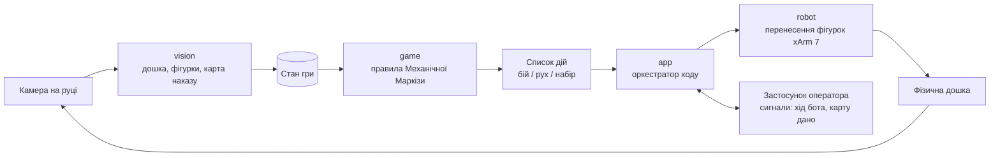

# Огляд проєкту

## Ідея

Механічна Маркіза — це бот, який грає за чіткими правилами: відкриває карту наказу, і масть карти визначає,
на яких галявинах він атакує, рухається й набирає воїнів. Людині грати за такого бота нудно, бо це механічна
робота. Тому ми віддаємо її роботу: **камера** знімає дошку і рахує фігурки на кожній галявині, **ігровий рушій**
застосовує правила бота й видає список дій, **роборука** виконує ці дії фізично.

## Як це працює

Хід бота складається з таких кроків:

1. Люди завершують свої ходи й натискають «Хід бота».
2. Камера фотографує дошку, `vision` перетворює фото на стан: скільки чиїх фігурок стоїть на кожній галявині.
3. Оператор перевертає ліву карту наказу. Камера розпізнає її масть і вартість крафту.
4. `game` застосовує правила Механічної Маркізи й видає дії: «бій на галявині 3», «перемісти 2 воїнів з 3 на 7»,
   «додай 1 воїна на 5».
5. `app` проводить бої (кидки кубиків, люди знімають свої втрати) і дає команди роботу.
6. `robot` бере фігурки із запасу чи з галявин і ставить їх куди треба, а потім повертається в «домашню» позицію.
7. Камера перевіряє результат, і хід переходить до людей.

Детальніше: [architecture.md](architecture.md).
