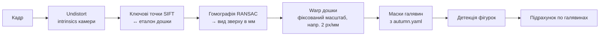

# Комп'ютерний зір

## Задачі

| # | Задача | Що повертає | Пріоритет |
| --- | --- | --- | --- |
| V1 | Знайти дошку на кадрі (без маркерів) | гомографія зображення → дошка (мм) | MVP |
| V2 | Порахувати фігурки по галявинах | `{галявина: {фракція: кількість}}` | MVP |
| V3 | Знайти точні позиції воїнів бота | координати (мм) для захвату | MVP |
| V4 | Знайти Keep | галявина з Keep | MVP (або ручне введення) |
| V5 | Прочитати карту наказу | масть + вартість крафту | стретч (MVP: ручне введення в UI) |
| V6 | Знайти вільне місце в галявині | точка (мм), куди можна поставити воїна | MVP |
| V7 | Перевірити, що робот поставив фігурку | так / ні | бажано |

## Камера

- **Фіксована камера над столом**, об'єктив дивиться вниз. Рішення й обґрунтування:
  [decisions/0002-fixed-overhead-camera.md](decisions/0002-fixed-overhead-camera.md).
- Мінімум 1080p, бажано з ручним фокусом і експозицією: автоекспозиція «пливе», коли рука заходить у кадр.
- Освітлення рівне, без бліків. Дошка глянцева, тому лампу ставимо збоку, а не прямо над дошкою.
  Блики ще й «з'їдають» ключові точки, за якими ми шукаємо дошку (див. V1).
- Знімаємо лише коли рука в **home**-позиції й не перекриває дошку.

## Пайплайн

### V1: дошка й планшет бота

Маркерів **немає**: дошку й планшет фракції бота знаходимо за їхнім власним малюнком. Чому так:
[decisions/0003-markerless-board-detection.md](decisions/0003-markerless-board-detection.md).

**Крок знаходження дошки — підготовка еталонів (один раз):**

1. **Знімок.** Планшет бота (~A4) сканувати сканером, 300–600 dpi. Дошку (~58×44 см) — сканувати частинами або
   сфотографувати строго зверху при рівному світлі, без спалаху й бліків.
2. **Розміри.** Лінійкою виміряти зовнішні розміри дошки й планшета (±1 мм) → `board.size_mm`, `supply.board_size_mm`.
3. **`scripts/make_board_reference.py`:**
   - вирівнює знімок: якщо це фото, клікаємо 4 кути (або передаємо їх у `--corners`), і знімок розтягується
     в прямокутник за розмірами в мм. Кути — по порядку: лівий верхній (0, 0) → правий верхній (біля лого ROOT)
     → правий нижній → лівий нижній; порядок і задає орієнтацію, тож саме фото може лежати як завгодно.
     Скан, уже обрізаний по краях, — з `--aligned`, без кліків;
   - задає систему координат: кут (0, 0), масштаб `board.warp_px_per_mm` (2 px/мм).
     **Орієнтація дошки:** лого ROOT праворуч угорі, доріжка рахунку внизу (X праворуч, Y донизу) — так само,
     як задані центри галявин у `config/maps/autumn.yaml`. SIFT не зважає на поворот: еталон, знятий повернутим
     на 180°, дошку знайде, але всі галявини мовчки з'їдуть у дзеркальні місця (`x' = 570 − x`, `y' = 440 − y`).
     Найнадійніше робити еталон з того самого фото `IMG_20261106_114643.jpg`, з якого брали центри галявин, у тій
     самій орієнтації. Для перевірки скрипт зберігає `<name>_check.png` — кола галявин з карти поверх еталона:
     вони мають лягти на галявини;
   - зберігає `data/reference/<board_autumn|bot_board>.png` (вирівняне зображення) і `.yaml` (розміри, масштаб).
     Характерні точки (`cv2.SIFT`) з еталона рахує сам `BoardDetector` на старті, окремо їх не зберігаємо;
   - перевіряє себе: шукає еталон на кадрах з `--frames` (за замовчуванням `camera.folder`) так само, як бот,
     і зберігає накладення еталона на кожен кадр у `data/reference/<name>_frames/`.
4. **Розмітка на еталонах:** межі 12 галявин на дошці (якщо в `config/maps/autumn.yaml` лише центри) і область
   запасу котів на планшеті бота.

Еталони в git не комітимо (це скани дошки), ділимося ними як вагами моделей. Перезнімати — якщо змінилося світло,
камера, або дошку чи планшет замінили.

**Ціль: на кожному огляді знаємо, де дошка.** Позу дошки в системі робота рахуємо заново з кадрів кожного огляду,
а не беремо з одноразового калібрування «дошка → робот». Дошку зсунули — наступний огляд дає нову позу, і рука
бере фігурки вже за нею; упори й прохання «поверніть дошку на місце» не потрібні. Обмеження одне: дошка не має
рухатися між оглядом і захватом.

**На кожному огляді** (код: [`vision/board_detector.py`](../src/rootbot/vision/board_detector.py), результат — `BoardHomography`):

- кадр → `cv2.SIFT` → `BFMatcher.knnMatch` з дескрипторами еталона → тест Лоу (0.75) →
  `cv2.findHomography(..., cv2.RANSAC)`: пари «піксель ↔ мм еталона»;
- з цих пар і intrinsics камери `cv2.solvePnP` дає позу дошки відносно камери — уже з одного кадру, бо дошка
  плоска й розмір її відомий;
- поза камери в мить знімка = поза фланця руки (`tcp_pose`) × hand-eye; разом виходить поза дошки (і окремо
  планшета) в системі робота;
- кілька оглядових кадрів зводяться в одну позу; розкид між кадрами — оцінка точності (ціль 1–2 мм).

Дошку не обов'язково бачити цілком: для пози досить кількох десятків точок з видимої частини (на кадрах з руки,
де видно 73 % дошки, точок понад 800). Але кут повороту, знайдений по невеликому шматку, далеко від нього
дає зсув (0,2° на відстані 500 мм — близько 2 мм), тому кадри огляду мають разом покривати всю дошку.

Фігурки в мм дошки рахуються з гомографії кожного кадру й від пози дошки не залежать. Поза потрібна лише
для руки: перевести мм дошки в координати робота.

**Де це житиме** (заплановано, коду ще немає; потрібне hand-eye — [calibration.md, крок 3](calibration.md)):

- `robot/scan.py`: `Scanner.scan()` віддає разом з кадром позу фланця в мить знімка;
- `vision/board_pose.py`: пари «піксель ↔ мм» + intrinsics → поза дошки відносно камери; тип `BoardPose` —
  поза дошки в системі робота (матриця 4×4, «точка дошки в мм → x, y, z робота»). Позу фланця й hand-eye
  отримує як числа, про руку нічого не знає;
- `vision/detector.py`: `add_frames()` рахує позу для кожного кадру (гомографія там уже є);
  `detect()` один раз на огляд відкидає кадри-викиди, зводить решту в одну позу й кладе її в
  `BoardObservation.board_pose`; `refine()` зводить заново, якщо додалися кадри;
- `robot/transforms.py`: мм дошки → мм робота через `BoardPose` (замість калібрування `board_to_robot.yaml`);
- `app/orchestrator.py`: `ScanBoard` зберігає позу з кожного огляду, `Manipulator` бере фігурки за нею.

**Перевірки:** правильних пар не менше за `board.detector.min_inliers`; дошка лежить у площині стола (нахил ≈ 0);
розкид пози між кадрами огляду в межах точності, інакше кадри-викиди відкидаємо або переглядаємо.
Якщо поза змінилася від попереднього огляду більше ніж на `board.max_shift_mm`, це не помилка: пишемо в лог
і показуємо оператору «дошку зсунули, позу оновлено».
**Запасний варіант:** якщо дошку не знайдено, беремо останню добру позу й показуємо попередження; якщо доброї ще не
було, оператор клікає 4 кути в UI.

Фігурка належить найближчій до точки її основи (мм дошки) галявині: точка основи поки без поправки на висоту
фігурки й нахил камери, тож межа кола галявини тут ненадійна. Галявину отримують воїни, будівлі, жетони, пішак
і Keep у межах дошки; фігурки поза дошкою (планшети людей, коробки) і маркери рахунку — ні, а коти бота в межах
планшета бота — це його запас.
Точки основи фігурок `BoardObservation` дає двічі: `positions` — по фракціях, лише фігурки, які рахуються
(рука бере звідси фігурки бота); `occupied` — усі зайняті точки галявини, разом з Keep і чужими фігурками
(з них `MovePlanner` рахує вільні місця).

### V2–V4: фігурки

Почнемо з найпростішого, ускладнюватимемо лише за потреби:

1. **v0: колір (HSV-пороги).** Фігурки фракцій мають різні кольори: Маркіза помаранчева,
   Династія (Eyrie) синя, Альянс зелений… Сегментуємо за кольором, знаходимо зв'язні області, рахуємо.
   Проблема: фігурки, що стоять впритул, зливаються в одну область. Частково допомагає розділення за площею
   (одна область приблизно = N фігурок).
2. **v1: детектор (YOLO).** Якщо v0 помиляється частіше, ніж у ~5% кадрів. Клас = фракція × тип фігурки.
   Датасет знімаємо на нашій же дошці (`scripts/capture_dataset.py`), розмічаємо в Label Studio чи CVAT.
   Кілька сотень кадрів має вистачити для старту. ❓ Уточнити, чи є доступ до GPU в університеті.

Keep — жетон, а не воїн. Колір його відрізняється від воїнів, тож його можна шукати окремим класом.
Якщо не вийде, оператор вводить галявину Keep один раз на початку гри (Keep не рухається, його можна лише знищити).
Keep є рівно тоді, коли його розпізнано на його галявині: галявина, яку видно цілком без Keep, означає, що Keep знищено.

### V5: карта наказу

- Відкрита карта лежить у **фіксованій зоні** на столі (позначеній стрічкою), камера бачить її на тому ж кадрі.
- Масть визначаємо за кольором фону або значком масті.
- Вартість крафту: шаблонний пошук значків мастей (template matching) у відомій області карти.
- **MVP:** оператор обирає масть і вартість у UI за 2 кліки. Розпізнавання камерою — стретч-ціль, якщо лишиться час до код-фризу (07.12).

### V6: вільне місце

Детектор каже лише, хто де стоїть: `BoardObservation.positions` (фігурки по фракціях, звідси коти
бота) і `BoardObservation.occupied` (усі зайняті точки: фігурки будь-якої фракції й виду, разом
з Keep). Вільне місце шукає `MovePlanner` (`app/move_planner.py`).

- Кандидати йдуть кільцями від центру галявини через `board.piece_spacing_mm / 2`. Вільна точка —
  не ближче за `board.piece_spacing_mm` до будь-якої зайнятої точки; береться перша, тобто найближча
  до центру.
- Коли в колі галявини (`radius_mm` з мапи) вільної точки немає, кільця йдуть далі за коло, поки на кільці
  є точки на дошці (`board.size_mm`), ближчі до центру цієї галявини, ніж до будь-якої іншої: детектор
  зараховує фігурку на найближчу галявину, тож поставлена там фігурка лічиться на цю.
- Коли вільної точки немає й там, береться найменш тісна точка кола — найдальша від найближчої
  зайнятої точки, з попередженням у лозі.

Заплановане `MovePlanner` тримає як цілі (`goals`): переміщення, яких рука ще не виконала, разом
з жетоном рахунку. Кота, який уже є джерелом цілі, він удруге не бере, а місця, куди цілі ставлять
фігурки, вважає зайнятими. Картину дошки (`bot_positions`, `occupied`) змінює лише `done(task)` — коли
рука справді перенесла фігурку; `drop_goals()` забуває всі цілі перерваного ходу. Огляд між
плануванням і `done` може трохи зсунути ту саму фігурку, тож точку кота з джерелом цілі `MovePlanner`
зіставляє в межах `board.piece_spacing_mm / 2`.

Огляд оновлює картину лише на галявинах, які бачив; інші галявини зберігають відомі `MovePlanner` місця,
а цілі лишаються як є. Коли треба взяти з галявини або поставити на галявину, якої `MovePlanner`
не знає, він просить огляд — кидає `ClearingNeedsScan` до будь-якої зміни; Orchestrator оглядає цю
галявину й повторює крок. Не знає — це для взяття менше відомих місць котів бота, не зайнятих цілями,
ніж треба взяти, а для постановки — галявина, якої ще не покрив жоден огляд. Галявина, яку огляд
бачив порожньою, відома.

## Датасет і дані

- `data/raw/`: сирі кадри, `data/labeled/`: розмічені. Обидві теки **в `.gitignore`**.
- Для тестів кладемо кілька маленьких кадрів у `tests/vision/fixtures/` (до ~1 МБ кожен).
- Ваги моделей лежать у `models/`, еталон дошки в `data/reference/` (теж ignored).
  Де зберігати їх спільно (Google Drive, HF Hub), домовимось окремо.

## Метрики

| Метрика | Ціль MVP |
| --- | --- |
| Дошку знайдено без запасного варіанту | ≥ 99% кадрів |
| Точність підрахунку фігурок на галявині | ≥ 95% галявин без помилки |
| Похибка позиції воїна бота | ≤ 5 мм |
| Час обробки кадру | ≤ 2 с |
