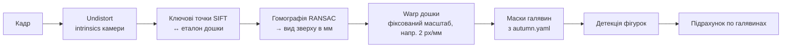

# Комп'ютерний зір

Вимоги (FR/NFR) і компоненти: [requirements/detector.md](requirements/detector.md).

## Задачі

| # | Задача | Що повертає | Пріоритет |
| --- | --- | --- | --- |
| V1 | Знайти дошку на кадрі (без маркерів) | гомографія зображення → дошка (мм) | MVP |
| V2 | Порахувати фігурки по галявинах | `{галявина: {фракція: кількість}}` | MVP |
| V3 | Знайти точні позиції воїнів бота | координати (мм) для захвату | MVP |
| V4 | Знайти Keep | галявина з Keep | MVP (або ручне введення) |
| V5 | Прочитати карту наказу | масть + вартість крафту | стретч (MVP: ручне введення в UI) |
| V6 | ~~Знайти вільне місце в галявині~~ — рахує `MovePlanner`, не зір ([FR-P4](requirements/orchestrator.md)) | — | — |
| V7 | Перевірити, що робот поставив фігурку | так / ні | бажано |

## Камера

- **Камера на руці** (eye-in-hand), об'єктив дивиться вниз уздовж осі інструмента. Рішення й обґрунтування:
  [decisions/0005-camera-on-arm.md](decisions/0005-camera-on-arm.md) (замінило фіксовану камеру з 0002).
- Кадри щоразу з іншого ракурсу: огляд дошки з 1–4 поз, зблизька перед захватом. Детектор має працювати
  під кутом і на різній висоті (саме такі ракурси в синтетиці `v7_simulation`).
- Мінімум 1080p, бажано з ручним фокусом і експозицією: автоекспозиція «пливе», коли рука заходить у кадр.
- Освітлення рівне, без бліків. Дошка глянцева, тому лампу ставимо збоку, а не прямо над дошкою.
  Блики ще й «з'їдають» ключові точки, за якими ми шукаємо дошку (див. V1).
- Знімаємо **лише на зупинках** руки (у русі кадр розмитий), з фіксованою експозицією.

## Пайплайн

### V1: дошка й планшет бота

Маркерів **немає**: дошку й планшет фракції бота знаходимо за їхнім власним малюнком. Чому так:
[decisions/0003-markerless-board-detection.md](decisions/0003-markerless-board-detection.md).

**Крок знаходження дошки — підготовка еталонів (один раз):**

1. **Знімок.** Планшет бота (~A4) сканувати сканером, 300–600 dpi. Дошку (~58×44 см) — сканувати частинами або
   сфотографувати строго зверху при рівному світлі, без спалаху й бліків.
2. **Розміри.** Лінійкою виміряти зовнішні розміри дошки й планшета (±1 мм) → `board.size_mm`, `supply.board_size_mm`.
3. **`scripts/make_board_reference.py`:**
   - вирівнює знімок: якщо це фото, клікаємо 4 кути, і знімок розтягується в прямокутник за розмірами в мм;
   - задає систему координат: кут (0, 0), масштаб `board.warp_px_per_mm` (2 px/мм);
   - сам знаходить характерні точки (`cv2.SIFT`, тисячі штук) і їхні дескриптори;
   - зберігає `data/reference/<board_autumn|bot_board>.png` (вирівняне зображення), `.npz` (точки в мм + дескриптори)
     і `.yaml` (розміри, масштаб, дата);
   - перевіряє себе: шукає еталон на кількох кадрах і показує накладення еталона на кадр.
4. **Розмітка на еталонах:** межі 12 галявин на дошці (якщо в `config/maps/autumn.yaml` лише центри) і область
   запасу котів на планшеті бота.

Еталони в git не комітимо (це скани дошки), ділимося ними як вагами моделей. Перезнімати — якщо змінилося світло,
камера, або дошку чи планшет замінили.

**На кожному огляді** (код: [`vision/board_detector.py`](../src/rootbot/vision/board_detector.py), результат — `BoardHomography`):

- кадр → `cv2.SIFT` → `BFMatcher.knnMatch` з дескрипторами еталона → тест Лоу (0.75) →
  `cv2.findHomography(..., cv2.RANSAC)`: пари «піксель ↔ мм еталона»;
- з цих пар і пози камери (рука × hand-eye) `solvePnP` дає позу дошки (і окремо планшета) в системі робота;
- кілька оглядових кадрів зводяться в одну позу; розкид між кадрами — оцінка точності (ціль 1–2 мм).

**Перевірки:** правильних пар не менше за `board.detector.min_inliers`; дошка лежить у площині з калібрування
(нахил ≈ 0); зсув відносно попереднього огляду ≤ `board.max_shift_mm`, інакше попередження оператору.
**Запасний варіант:** якщо дошку не знайдено, беремо останню добру позу й показуємо попередження; якщо доброї ще не
було, оператор клікає 4 кути в UI.

Фігурка належить галявині, якщо точка її основи в мм дошки потрапляє в межі галявини; фігурки поза галявинами
(планшети людей, коробки) ігноруються, а коти бота в межах планшета бота — це його запас.

### V2–V4: фігурки

Почнемо з найпростішого, ускладнюватимемо лише за потреби:

1. **v0: колір (HSV-пороги).** Фігурки фракцій мають різні кольори: Маркіза помаранчева,
   Династія (Eyrie) синя, Альянс зелений… Сегментуємо за кольором, знаходимо зв'язні області, рахуємо.
   Проблема: фігурки, що стоять впритул, зливаються в одну область. Частково допомагає розділення за площею
   (одна область приблизно = N фігурок).
2. **v1: детектор (YOLO).** Якщо v0 помиляється частіше, ніж у ~5% кадрів. Клас = фракція × тип фігурки.
   Датасет знімаємо на нашій же дошці (`scripts/capture_dataset.py`), розмічаємо в Label Studio чи CVAT.
   Кілька сотень кадрів має вистачити для старту. ❓ Уточнити, чи є доступ до GPU в університеті.
   Перша версія детектора вже є: YOLO11, натренований на рендерах 3D-скану, дає 9/12 галявин точно
   на реальних фото іншої розстановки (з голосуванням по кадрах). Усі промахи в купках. Див. [ml.md](ml.md).

Keep — жетон, а не воїн. Колір його відрізняється від воїнів, тож його можна шукати окремим класом.
Якщо не вийде, оператор вводить галявину Keep один раз на початку гри (Keep не рухається, його можна лише знищити).

### V5: карта наказу

- Відкрита карта лежить у **фіксованій зоні** на столі (позначеній стрічкою), камера бачить її на тому ж кадрі.
- Масть визначаємо за кольором фону або значком масті.
- Вартість крафту: шаблонний пошук значків мастей (template matching) у відомій області карти.
- **MVP:** оператор обирає масть і вартість у UI за 2 кліки. Розпізнавання камерою — стретч-ціль, якщо лишиться час до код-фризу (07.12).

## Датасет і дані

- `data/raw/`: сирі кадри з камери робота, `data/labeled/`: розмічені датасети. Обидві теки **в `.gitignore`**.
- Крім знятих кадрів, у нас є **датасет із 3D-сканів** справжньої партії: рендери сцени з точними YOLO-мітками
  (`data/labeled/synth_v1`) і реальні кадри сканера з мітками (`data/labeled/real`). Як він зроблений, які результати
  вже є і як його перегенерувати: [ml.md](ml.md).
- Для тестів кладемо кілька маленьких кадрів у `tests/vision/fixtures/` (до ~1 МБ кожен).
- Ваги моделей лежать у `models/`, еталон дошки в `data/reference/` (теж ignored).
  Де зберігати їх спільно, домовимось окремо (пропозиція: DVC, див. [ml.md → Що далі](ml.md#що-далі)).

## Метрики

| Метрика | Ціль MVP |
| --- | --- |
| Дошку знайдено без запасного варіанту | ≥ 99% кадрів |
| Точність підрахунку фігурок на галявині | ≥ 95% галявин без помилки |
| Похибка позиції воїна бота | ≤ 5 мм |
| Час обробки кадру | ≤ 2 с |
